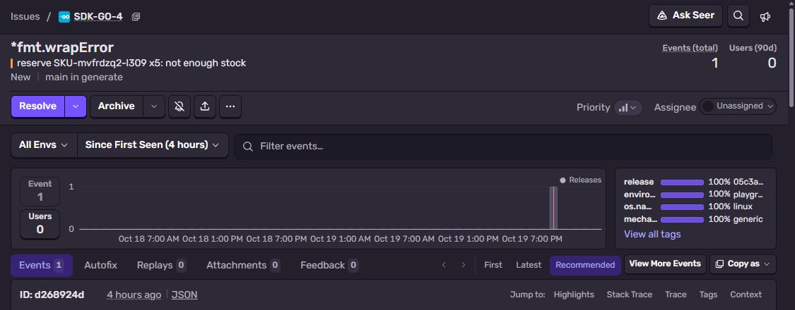
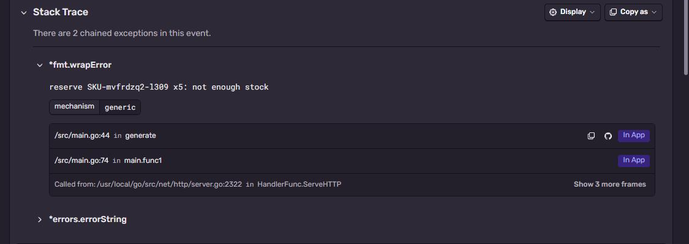

# Sentry + Go

`net/http` server with `sentry-go`. Two cases: a returned `error`, and a `panic` that is recovered and
reported.
Part of [Sentry Playground](https://github.com/fsmaster/sentry-playground).



## What you need

- Go 1.24+
- Sentry project with platform **Go**

## 1. Get the DSN

Sentry → **Settings → Projects → (project) → Client Keys (DSN)**.

## 2. Run it

```bash
git clone https://github.com/fsmaster/sentry-sample-go.git
cd sentry-sample-go
export SENTRY_DSN="https://<key>@<org>.ingest.us.sentry.io/<project-id>"
go run . error
go run . panic
```

Each prints `event id: ...`. `go run . serve` starts HTTP server on `:8080` with `POST /trigger`, this
is what the playground uses.

## 3. Check it in Sentry

Two issues:

- `*fmt.wrapError: reserve SKU-... x5: not enough stock`. Shown as **2 chained exceptions**: the wrapper
  and the original `errNoStock` (`%w` unwraps). Stack trace ends in `generate`, see below why
- `runtime.errorString: runtime error: integer divide by zero`, here stack trace ends in `divide`, the
  place of the panic



## How it works

```go
err := sentry.Init(sentry.ClientOptions{
	Dsn:              os.Getenv("SENTRY_DSN"),
	AttachStacktrace: true,
})
defer sentry.Flush(5 * time.Second)
```

Go has no global exception handler, so you report things yourself:

- `sentry.CaptureException(err)` for an `error`
- `defer sentry.Recover()` (or `hub.Recover(r)` inside your own `recover()`) for a panic

The sample clones the hub per request (`sentry.CurrentHub().Clone()`). Tags and fingerprint set on the
clone don't leak into other requests. For real HTTP servers use the `sentryhttp` middleware, it does
the clone + recover for you.

A Go `error` is just a value, it has no stack trace inside. With `AttachStacktrace: true` the SDK records
the stack at the moment you call `CaptureException`, so the top frame is where you *reported* it, not
where it was created. If you need the origin, wrap errors with a library that records stacks
(`github.com/pkg/errors`), sentry-go reads those. A panic is different, `Recover` gets the real stack.

Go binaries keep function names and file:line, Sentry shows frames without symbol upload. Go source is
not sent with the event, so there is no code inline, but with GitHub integration + code mapping
(`/src/` → repo root here) each frame has a link to the line on GitHub.

`/trigger` also takes an optional `"dsn"` in the body. The playground sends it when a visitor checks
**Use my DSN**, then only this one event goes to their project (a separate client, the global one is untouched).

## Troubleshooting

| Symptom | Why |
|---|---|
| Nothing arrives from a CLI tool | Missing `sentry.Flush(...)` before `main` returns. Events are sent async. |
| Panic crashes the process, no event | Panic happened in a goroutine without its own `defer sentry.Recover()`. Recover works per goroutine. |
